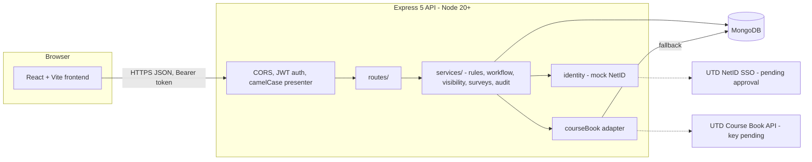
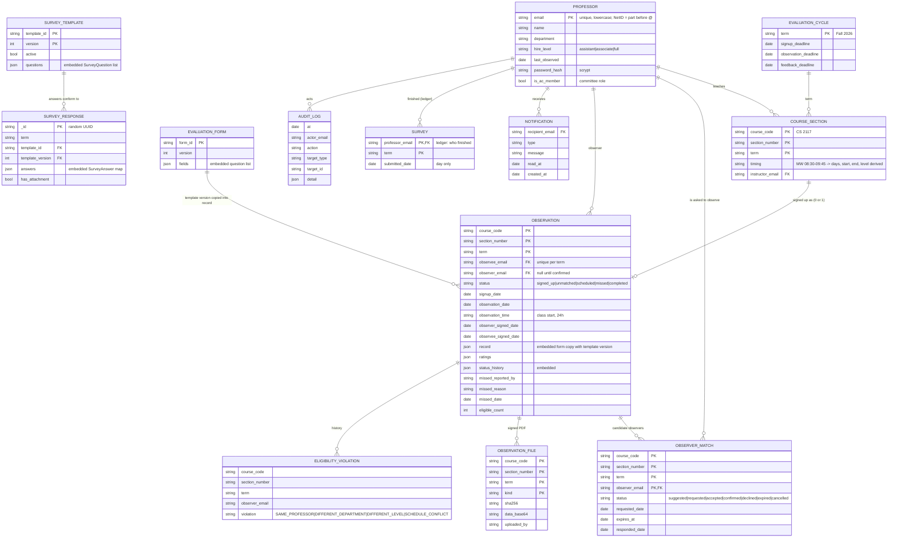

# Architecture, data model and decisions

This answers the TA's feedback on the proposal (ER diagram, database and backend choice, architecture, NetID, Course Book,
API contract, testing and deployment).

## Decisions (the TA's "conflicts")

| Question | Decision | Why |
|---|---|---|
| Backend language | **Node.js** (Express 5), CommonJS | The team already built the schema, seed and setup scripts in Node. The abstract's "Python" is wrong and should be corrected. |
| Database | **MongoDB** (Mongoose 9) | Same reason. NFR6 ("MySQL, MongoDB rejected") should be changed to MongoDB. |
| Normalization worry | Relationships are kept by **reference** (emails and the `course_code + section_number + term` triple) with unique indexes, and each fact has one owner; only things that belong to one parent are **embedded**. | See "Embed or reference" below. |
| Auth | Password login now; **NetID through a mock identity provider** (ticket, callback). | Real UTD single sign-on needs university approval. |
| Course data | **Adapter** with timeout, retry, cache and fallback to our own sections. | The Course Book key is pending. |
| API contract | **OpenAPI 3** generated from code-checked data. | `docs/openapi.json`, `GET /api/docs/openapi.json`. |

## Architecture

Layers: `routes/` (HTTP only) -> `services/` (rules and workflow, unit-testable) -> `models/` (Mongoose). Cross-cutting:
`middleware/` (auth, CORS, errors, snake_case <-> camelCase), `jobs/` (sweeps: expire requests after 48 h, mark missed
observations). Authorization is checked on every request from the database (`is_ac_member`), so removing a committee member takes effect at once.

## Entity-relationship diagram

Relationships are logical (MongoDB does not enforce foreign keys; the unique indexes listed below are enforced).

The TA asked for explicit SurveyQuestion and SurveyAnswer entities. In MongoDB they are **embedded** documents: a
`SurveyQuestion` is `{key, label, type, required, min, max, max_length}` inside `SurveyTemplate.questions`, and a
`SurveyAnswer` is one `key: value` inside `SurveyResponse.answers`, validated against the template version stored on the response.
(In MySQL these would be tables; here they cannot be queried or edited on their own, and nothing needs that.)

### Fields the TA listed, and where they live

| TA's need | Where |
|---|---|
| NetID / identity reference | `professors.email`; NetID = the part before `@`; `GET /api/me`, `/api/auth/netid/*` |
| Roles | `is_ac_member` (committee) and being a professor; derived by `services/permissions.js` |
| Department, course level | `professors.department`; level derived from `course_code` ("CS 3345" -> 3) |
| Meeting days / times | `course_sections.timing`, parsed to `days`, `startTime`, `endTime` |
| Eligibility status / reason, rule version | computed per request by `services/facultyEligibility.js`; `RULE_VERSION` in `config/rules.js` |
| Due / overdue | computed from `last_observed` and `hire_level` (never stored, so it cannot go stale) |
| Request status, decline | `observer_matches.status`, `responded_date` |
| Observation status, history | `observations.status`, `status_history` |
| Survey status | `surveys` ledger + `GET /api/surveys/status` |
| KPI timestamps | `signup_date`, `confirmed_date`, `observation_date`, signed dates, `completed_date` |

## Embed or reference, and who owns each fact

| Fact | Decision | Owner |
|---|---|---|
| Section identity | Reference by the triple `(course_code, section_number, term)` | `course_sections` |
| Instructor on an observation | `observee_email` is stored (also derivable from the section) so one query finds "my observation this term" and a unique index stops two signups per person per term | `observations` |
| Observer candidates | **Separate** collection (many per observation, each with its own status and expiry) | `observer_matches` |
| Form copy filled in by the observer | **Embedded** in the observation (`record`) with the template version, so editing the template later never changes a past observation | `observations` |
| Status history | **Embedded** array on the observation | `observations` |
| Survey questions / answers | **Embedded** in template / response | `survey_templates`, `survey_responses` |
| Signed PDF | Separate collection (large, base64) | `observation_files` |
| Due / overdue, eligibility | **Not stored**: computed | services |

Duplicated data is limited to `observee_email` (above) and the section triple copied onto observations, matches and files.

## Indexes (enforced uniqueness in bold)

- professors: **email**
- course_sections: **(course_code, section_number, term)**; (term, instructor_email)
- evaluation_cycles: **term**
- observations: **(course_code, section_number, term)**; **(observee_email, term)** where observee_email is a string; (status, observation_date)
- observer_matches: **(course_code, section_number, term, observer_email)**; (status, expires_at); (observer_email)
- surveys: **(professor_email, term)**
- survey_templates: **(template_id, version)**; survey_responses: (term)
- evaluation_forms: **form_id**; observation_files: **(triple, kind)**
- notifications: (recipient_email, created_at desc); eligibility_violations: (term)
- audit_logs: (at desc), (actor_email, at desc), (action, at desc)

## Anonymous survey design

Two collections that do not point at each other: `surveys` records only *that* someone finished (and the day), and
`survey_responses` records the *answers* under a random UUID with no name, no time, no link back. Results are withheld until
`SURVEY_MIN_RESPONSES` (default 3) people answered. Limit: this is anonymity at the API level. Someone with full database
access could still try to correlate rows by their insertion order; we removed timestamps and use random ids to make that hard, not impossible.

## Report visibility rule (the committee's answer)

Observer: always. Observee: after the observer signs. Committee: after both sign. The observee can only sign after the observer.
Enforced in `services/visibility.js` and applied to every route that returns an observation or the PDF.

## What is not real yet

Real UTD single sign-on, real Course Book data, email delivery, and any run against a live MongoDB (see README Limits).
